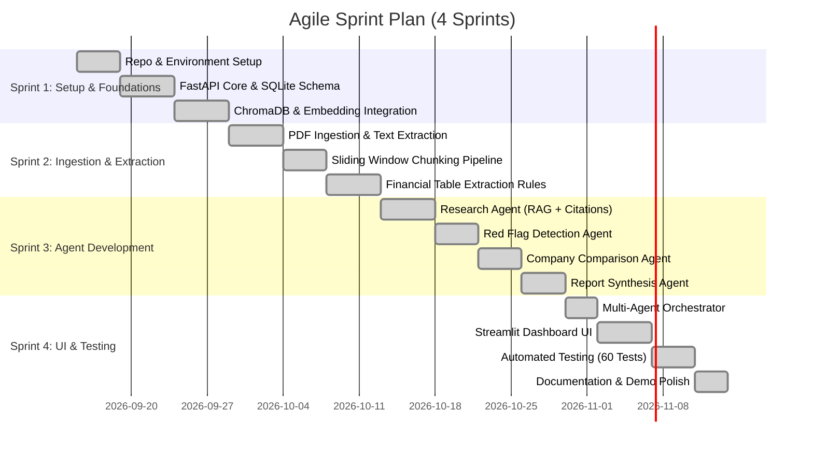

# Agile Project Documentation

## Project Name
**Multi-Agent AI Analysis System for Financial Research and Business Insights**

**Internship Context:** Infosys Springboard AI Virtual Internship
**Project Type:** Individual AI Capstone Project
**Tech Stack:** Python 3.12, FastAPI, SQLite (SQLAlchemy), ChromaDB, Sentence Transformers / Google Embeddings, Gemini API, Streamlit

---

## 1. Project Overview
Financial reports such as corporate annual reports (10-K, Integrated Annual Reports) are dense, multi-hundred-page PDF documents containing complex financial tables, narrative disclosures, and accounting notes. Manual analysis requires substantial effort and is prone to oversight.

This project delivers an automated, audit-ready **Multi-Agent Financial Research System** that ingests financial PDFs, parses and stores content using vector retrieval (RAG), and coordinates specialized autonomous agents to extract financial metrics, detect revenue declines and red flags, compare peer companies, answer queries with exact page citations, and compile executive reports.

---

## 2. Product Vision
To empower financial analysts, investors, and auditors with a transparent, verifiable AI platform that transforms unstructured corporate financial filings into structured insights, eliminating numerical hallucinations through strict page-level citation tracing and deterministic mathematical verification.

---

## 3. Epics Mapped to Milestones

| Epic ID | Epic Name | Milestone Alignment | Objective |
|---|---|---|---|
| **EPC-01** | **Foundational RAG Architecture** | **Milestone 1** | Establish development environment, vector database integration (ChromaDB), relational schema (SQLite), and embedding pipelines. |
| **EPC-02** | **Document Parsing & Entity Extraction** | **Milestone 2** | Implement PDF text extraction, sliding-window chunking, semantic vector indexing, and table parsing for financial metrics. |
| **EPC-03** | **Specialized Financial Agents** | **Milestone 3** | Develop dedicated agents: Research Agent (RAG + Q&A), Red Flag Agent (anomaly detection), Comparison Agent (cross-company analysis), and Report Agent (executive summaries). |
| **EPC-04** | **Multi-Agent Orchestration & Interactive UI** | **Milestone 3** | Build central workflow orchestrator, REST API endpoints via FastAPI, and a user-friendly Streamlit web interface. |

---

## 4. Key User Stories & Acceptance Criteria

### User Story 1: Document Upload & Ingestion (EPC-01, EPC-02)
> **As an** equity analyst,
> **I want to** upload multi-page corporate annual reports (PDF format),
> **So that** the system extracts, processes, and prepares the document for semantic search.

**Acceptance Criteria:**
- The system accepts standard PDF documents via a FastAPI upload endpoint and Streamlit UI.
- File metadata (file name, file size, upload timestamp, assigned document ID) is saved to the SQLite database.
- Text is extracted page-by-page preserving page numbers.

---

### User Story 2: Chunking & Vector Store Indexing (EPC-01, EPC-02)
> **As a** system user,
> **I want** the uploaded document content split into structured, overlapping chunks and embedded into a vector database,
> **So that** I can execute fast semantic queries across hundreds of pages.

**Acceptance Criteria:**
- Documents are split into overlapping text chunks with persistent chunk IDs and page references.
- High-dimensional vector embeddings are generated for every chunk.
- Embeddings and metadata are indexed in ChromaDB collections segregated by `document_id`.

---

### User Story 3: Financial Metric Extraction (EPC-02)
> **As a** researcher,
> **I want** key financial values (Revenue from Operations, Net Profit) extracted from standalone and consolidated tables,
> **So that** metrics can be analyzed quantitatively without manual data entry.

**Acceptance Criteria:**
- Financial numbers, currencies, units (e.g., ₹ in crore), and reported years are parsed from tabular disclosures.
- Candidates differentiate between consolidated and standalone accounting bases.
- Extracted values retain citations back to the source page and chunk.

---

### User Story 4: Citation-Backed Conversational Research (EPC-03)
> **As a** financial analyst,
> **I want to** ask natural-language questions about a company's financial performance,
> **So that** I receive accurate, hallucination-free answers backed by verifiable source page citations.

**Acceptance Criteria:**
- User queries retrieve top-$k$ relevant chunks from ChromaDB via similarity search.
- The LLM synthesizes an answer strictly based on the retrieved context.
- Every response includes direct citations (Document ID, Page Number, and Chunk ID).
- If the document lacks sufficient evidence, the agent explicitly states that information is unavailable instead of hallucinating.

---

### User Story 5: Revenue Decline & Red Flag Detection (EPC-03)
> **As a** risk manager,
> **I want** the system to automatically analyze year-over-year revenue movements,
> **So that** unexpected revenue drops or performance deterioration are flagged immediately.

**Acceptance Criteria:**
- Percentage changes are computed deterministically using standard formulas: `((Current - Previous) / Previous) * 100`.
- Revenue drops (e.g., negative year-over-year growth) generate a structured alert with unique flag ID, severity level (Medium/High), and source citation.
- Positive or flat revenue trends are reported as normal without false alerts.

---

### User Story 6: Multi-Company Peer Comparison (EPC-03)
> **As an** investor,
> **I want to** compare financial metrics across two or more uploaded companies for the same financial period,
> **So that** I can evaluate relative market standing side-by-side.

**Acceptance Criteria:**
- The system accepts two or more document IDs and aligns metrics across equivalent financial years and statement types.
- Differences are calculated in both absolute amounts and relative percentages.
- Incompatible units or missing metrics in peer documents are handled gracefully without application crashes.

---

### User Story 7: Executive Summary & Report Synthesis (EPC-03)
> **As an** executive,
> **I want** a consolidated financial report generated automatically,
> **So that** I can review high-level business performance, key financials, and risks in one view.

**Acceptance Criteria:**
- The Report Agent aggregates extracted metrics, red flag findings, and company background into a structured Markdown document.
- Report includes Company Overview, Key Financials Table, Red Flag Findings, and Executive Summary.
- Missing sections or API timeouts fall back to deterministic template summaries.

---

### User Story 8: Central Orchestration Pipeline (EPC-04)
> **As a** backend developer,
> **I want** an orchestrator that coordinates agent calls and task execution,
> **So that** multi-step user workflows (ingest $\rightarrow$ extract $\rightarrow$ analyze $\rightarrow$ report) run smoothly.

**Acceptance Criteria:**
- The Orchestrator routes requests to appropriate agents based on user intent.
- Maintains execution context and session states in the database.
- Provides standard REST API error handling and status codes.

---

### User Story 9: Interactive Streamlit Dashboard (EPC-04)
> **As an** end user,
> **I want** an intuitive web interface with distinct tabs for Uploads, Research Q&A, Red Flags, Comparison, and Reports,
> **So that** I can interact with the entire system without making manual API calls.

**Acceptance Criteria:**
- Streamlit application connects reliably to the FastAPI backend service.
- Provides sidebar document selection, metric summary cards, expandable citations, and downloadable Markdown reports.
- Real-time spinners indicate active agent processing status.

---

### User Story 10: Multi-Turn Conversation Memory (EPC-04)
> **As a** user,
> **I want** the research assistant to remember recent chat context within a session,
> **So that** I can ask follow-up questions naturally.

**Acceptance Criteria:**
- Chat history is persisted in SQLite by `session_id`.
- Follow-up questions leverage prior turn context for disambiguation.
- Sessions can be reset or cleared on demand from the interface.

---

## 5. Sprint Plan

### Sprint 1: Architecture & RAG Foundations (Milestone 1)
- **Goal:** Set up local development environment, FastAPI skeleton, SQLite database for session storage, and ChromaDB vector store.
- **Deliverables:**
  - Initialized repository and virtual environment.
  - SQLAlchemy models for documents, chunks, and sessions.
  - Basic embedding pipeline integrating Sentence Transformers / Google Embeddings.

### Sprint 2: PDF Parsing & Document Pipeline (Milestone 2)
- **Goal:** Enable reliable ingestion of corporate annual report PDFs and structured financial table extraction.
- **Deliverables:**
  - PDF document loader with page-level boundary tracking.
  - Text chunking utility with configurable chunk size and overlap.
  - Heuristic parser for financial statements (Revenue from Operations, Net Profit).

### Sprint 3: Core Multi-Agent Logic (Milestone 3 - Part 1)
- **Goal:** Implement the specialized analytical agents with mathematical precision and citation integrity.
- **Deliverables:**
  - **Research Agent:** RAG-backed Q&A returning context snippets and page citations.
  - **Red Flag Agent:** Deterministic YoY percentage calculation and decline alert rules.
  - **Comparison Agent:** Cross-document schema alignment and unit normalization.
  - **Report Agent:** Markdown executive summary generator.

### Sprint 4: Orchestration, Frontend UI & Quality Assurance (Milestone 3 - Part 2)
- **Goal:** Wire agents into a central orchestrator, build the Streamlit UI, and validate system stability with automated tests.
- **Deliverables:**
  - Orchestration pipeline coordinating agent execution.
  - Streamlit multi-tab user interface (`app.py`).
  - Comprehensive automated test suite (unit and integration tests covering calculation edge cases, missing data, and API contracts).

---

## 6. Definition of Done (DoD)

A user story or feature is marked **Done** only when:
1. **Code Quality:** Code is written cleanly in Python, following modular file structure (`agents/`, `services/`, `models.py`, `schemas.py`).
2. **Schema Validation:** All request and response payloads adhere to strict Pydantic models.
3. **Traceability:** Any metric or statement output by an agent includes a source citation (Document ID, Page Number, Chunk ID).
4. **Deterministic Math:** Numerical computations (growth percentages, differences) are executed in Python logic, never hallucinated by the LLM.
5. **Automated Testing:** Unit and integration test cases pass without errors or regressions.
6. **UI Integration:** The feature is accessible and validated in the interactive Streamlit dashboard.
7. **Documentation:** API endpoints, agent interfaces, and operational steps are documented in `README.md`.

---

## 7. Progress Summary

| Work Package | Status | Completion | Notes |
|---|---|:---:|---|
| SQLite Metadata & Session Store | **Completed** | 100% | Stores document records, upload metadata, and conversational history. |
| ChromaDB Vector Store Integration | **Completed** | 100% | Indexed collections with isolated document-level querying. |
| PDF Extraction & Chunking Engine | **Completed** | 100% | PyMuPDF-based parser preserving page coordinates and chunks. |
| Financial Extraction Rules | **Completed** | 100% | Extracted metrics from Reliance, TCS, and Infosys annual reports. |
| Research Agent (RAG + Q&A) | **Completed** | 100% | Strict citation retrieval, zero-hallucination fallback on low context. |
| Red Flag Anomaly Agent | **Completed** | 100% | Successfully identified Reliance standalone revenue decline (-2.76%, Page 58). |
| Cross-Company Comparison Agent | **Completed** | 100% | Side-by-side metric comparison with percentage variance. |
| Executive Report Synthesis Agent | **Completed** | 100% | Generates executive summary and financial summary tables. |
| Multi-Agent Orchestrator | **Completed** | 100% | Unified routing layer in `orchestrator.py`. |
| Streamlit Frontend Application | **Completed** | 100% | 5 dedicated dashboard views with real-time feedback. |
| Automated Test Suite | **Completed** | 100% | 60 test cases covering unit logic, arithmetic, and API behavior. |

---

## 8. Sprint Retrospective

### What Went Well (Successes)
- **Modular Multi-Agent Architecture:** Separating responsibilities across discrete agents (Research, Red Flag, Comparison, Report) kept the codebase maintainable and simplified debugging.
- **Deterministic Math Guardrails:** Enforcing Python arithmetic for percentage changes and differences completely eliminated numerical hallucinations commonly seen with pure LLM outputs.
- **Zero-Hallucination Design:** Combining ChromaDB vector retrieval with strict prompt constraints ensured that queries outside the document scope were transparently rejected as unanswerable.
- **Fast Interactive Testing:** Building the Streamlit frontend provided an immediate visual testing environment for real-world document evaluations.

### Challenges Faced
- **PDF Layout & Table Variability:** Corporate annual reports vary widely in formatting—some present data across nested tables, multi-column layouts, or varied accounting units (Crores vs. Lakhs vs. Millions). Designing robust heuristic extractors required iterative tuning.
- **Context Window Management:** Large PDF filings cannot be passed in full to an LLM. Tuning chunk sizes (800 characters) and chunk overlap (150 characters) was critical to avoid cutting table rows midway.
- **Streamlit Callout Rendering:** Streamlit container rendering behaviors in newer versions initially obscured nested alert details, requiring targeted UI component refactoring.

### Key Learnings
- **RAG Requires Data Discipline:** Retrieval quality directly depends on parsing and chunking quality. Investing time into document pre-processing yielded greater accuracy improvements than prompt engineering alone.
- **Multi-Agent Coordination:** Orchestrating multiple agents requires rigid input/output schema contracts (Pydantic) to ensure intermediate outputs pass reliably from one agent to the next.
- **Agile Value in Capstone Projects:** Breaking the project into 4 progressive sprints allowed steady incremental milestones, transforming complex enterprise requirements into manageable, testable components.
#Done