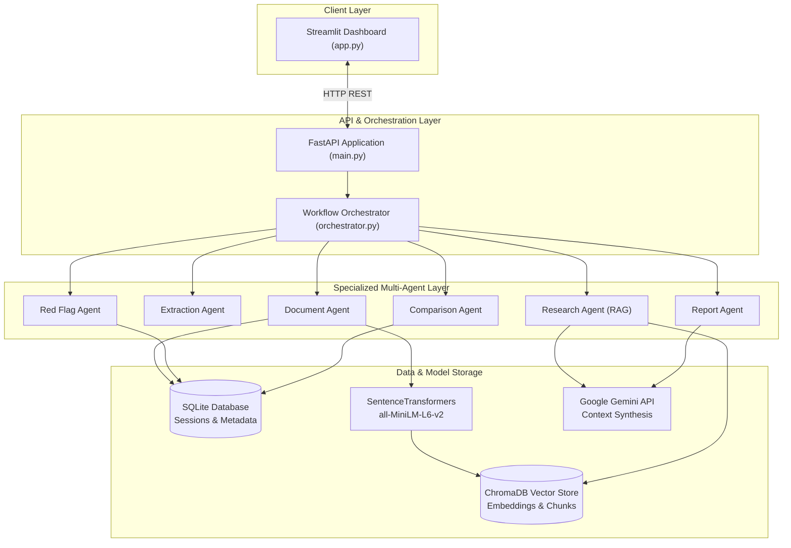

# Multi-Agent AI Analysis System for Financial Research and Business Insights

[](https://www.python.org/)
[](https://fastapi.tiangolo.com/)
[](https://streamlit.io/)
[](https://www.trychroma.com/)
[](LICENSE)

An automated, evidence-grounded research platform for corporate annual reports and financial filings. The system coordinates specialized AI agents to extract financial metrics, detect year-over-year revenue decline red flags, compare peer financials across companies, answer research questions with verifiable source page citations, and generate structured executive reports.

Developed as an individual capstone project for the **Infosys Springboard AI Virtual Internship**.

---

## 1. Problem Statement & Objectives

### The Problem
Corporate annual reports (such as Form 10-K or Integrated Annual Reports) are dense, multi-hundred-page PDF documents filled with complex financial statements, footnotes, and accounting disclosures. Manually analyzing and cross-referencing metrics across companies requires hours of expert review. Meanwhile, general-purpose LLMs struggle with multi-page table accuracy and frequently hallucinate financial figures.

### Project Objectives
- **Evidence-Grounded Retrieval**: Use Retrieval-Augmented Generation (RAG) and vector search to answer financial queries with strict page-level citations.
- **Zero-Hallucination Numerical Math**: Execute all growth calculations, percentage variances, and financial differences through deterministic Python logic rather than LLM text generation.
- **Specialized Multi-Agent Collaboration**: Decompose complex financial tasks across modular, purpose-built agents (Extraction, Research, Red Flag Detection, Company Comparison, and Executive Reporting).
- **Audit-Ready Traceability**: Ensure every financial insight connects directly back to its source document ID, page number, chunk ID, and original statement text.

---

## 2. Key Features

- **Document Ingestion & Chunking**: Extracts text and tabular content from annual report PDFs with PyMuPDF (`fitz`), segments text into sliding-window chunks with persistent page tracking, and indexes dense vector representations in ChromaDB.
- **Deterministic Financial Extraction**: Identifies company revenue and net profit figures while maintaining strict segregation between **consolidated** and **standalone** reporting bases.
- **Citation-Backed Financial Research**: Answers natural-language financial questions and returns exact references (PDF page number, chunk ID, statement type, and text snippet).
- **Automated Red Flag Detection**: Evaluates year-over-year revenue changes, flagging qualifying declines with severity tiers (`medium` for <20% decline, `high` for ≥20% decline).
- **Peer Company Comparison**: Compares financial metrics across multiple uploaded annual reports (e.g., Reliance vs. Infosys vs. TCS), computing absolute and percentage variances against a selected baseline.
- **Executive Report Generation**: Assembles an Executive Summary and structured Key Financials table with verified source citations.
- **Interactive Streamlit Web Dashboard**: Provides a multi-tab interface for document uploads, conversational research, red flag analysis, company comparisons, and report viewing.

---

## 3. Architecture Overview

The system uses a decoupled client-server architecture: a **FastAPI** backend orchestrates autonomous agents, vector search, and relational storage, while a **Streamlit** frontend provides an intuitive analyst dashboard.



---

## 4. Technology Stack

| Layer | Component | Technology | Purpose |
|---|---|---|---|
| **Language** | Core Runtime | Python 3.12 | Primary programming language |
| **Backend API** | Web Framework | FastAPI, Uvicorn, Pydantic | REST API endpoints, validation, and serialization |
| **Frontend** | Dashboard | Streamlit | Interactive multi-tab web user interface |
| **Relational Store**| Database | SQLite, SQLAlchemy ORM | Document metadata, sessions, and conversation history |
| **Vector Store** | Vector Search | ChromaDB | Chunk embeddings storage and cosine similarity retrieval |
| **Embeddings** | NLP Pipeline | SentenceTransformers (`all-MiniLM-L6-v2`) | Local dense semantic vector representations |
| **LLM Inference** | Synthesis | Google Gemini API (`gemini-2.5-flash`) | Context synthesis and executive summary drafting |
| **PDF Extraction**| Document Parser | PyMuPDF (`fitz`) | Multi-page text extraction and page coordinate tracking |
| **Quality** | Testing | Python `unittest` | Automated unit, calculation, and API integration testing |

---

## 5. Project Directory Structure

```text
Multi-agent-financial-research/
├── agents/                      # Specialized financial analysis agents
│   ├── comparison_agent.py      # Cross-company metric comparison & difference analysis
│   ├── document_agent.py        # PDF ingestion and processing coordinator
│   ├── extraction_agent.py      # P&L statement parsing & revenue extraction
│   ├── red_flag_agent.py        # Year-over-year revenue decline detection
│   ├── report_agent.py          # Executive Summary & Key Financials synthesis
│   └── research_agent.py        # Citation-backed conversational question answering
├── services/                    # Shared operational services
│   ├── chunker.py               # Sliding-window text chunking with overlap
│   ├── embedder.py              # SentenceTransformers vector embedding generation
│   ├── parser.py                # PyMuPDF text & page boundary extraction
│   └── vector_store.py          # ChromaDB collection management and semantic search
├── docs/                        # Project documentation
│   └── AGILE_DOCUMENTATION.md   # Agile user stories, sprint plans, DoD, and retrospective
├── uploads/                     # Staging directory for uploaded PDF documents
│   └── .gitkeep
├── .env.example                 # Environment configuration template
├── .gitignore                   # Version control exclusion rules
├── LICENSE                      # MIT License
├── README.md                    # Project landing page and documentation
├── api_client.py                # Frontend HTTP client connecting Streamlit to FastAPI
├── app.py                       # Streamlit multi-tab user interface
├── database.py                  # SQLite database engine and SQLAlchemy session factory
├── main.py                      # FastAPI application entry point and routing definitions
├── models.py                    # SQLAlchemy ORM database models
├── orchestrator.py              # Ingestion pipeline and agent coordination
├── requirements.txt             # Python runtime dependencies
├── schemas.py                   # Pydantic data validation schemas
├── test_comparison_agent.py     # Test suite for Comparison Agent
├── test_conversational_api.py   # Test suite for multi-turn conversational API
├── test_red_flag_agent.py       # Test suite for Red Flag Agent rules
├── test_report_agent.py         # Test suite for Report Agent synthesis
└── test_research_agent.py       # Test suite for Research Agent and RAG retrieval
```

---

## 6. Setup and Installation (Windows)

### Prerequisites
- Python 3.12 installed on your system
- Git installed on your system
- A Google Gemini API key (optional, for LLM report synthesis and open research queries)

### Step 1: Clone the Repository
```powershell
git clone https://github.com/silver592/Multi-agent-financial-research.git
cd Multi-agent-financial-research
```

### Step 2: Create and Activate a Virtual Environment
```powershell
python -m venv venv
.\venv\Scripts\activate
```

### Step 3: Install Dependencies
```powershell
pip install -r requirements.txt
```

### Step 4: Configure Environment Variables
Copy the example environment template and configure your API key:
```powershell
copy .env.example .env
```
Open `.env` in any text editor and provide your Gemini API key:
```ini
GEMINI_API_KEY=your_gemini_api_key_here
```

---

## 7. Starting the Application

The system requires both the FastAPI backend and the Streamlit frontend to run simultaneously.

### Terminal 1: Launch FastAPI Backend
```powershell
.\venv\Scripts\activate
uvicorn app.main:app --reload --host 127.0.0.1 --port 8000
```
*The interactive API documentation (Swagger UI) is accessible at: `http://127.0.0.1:8000/docs`*

### Terminal 2: Launch Streamlit Frontend
```powershell
.\venv\Scripts\activate
streamlit run app/app.py
```
*The web interface will automatically open in your default browser at: `http://localhost:8501`*

---

## 8. Running the Test Suite

The project includes unit and integration tests covering deterministic calculations, boundary conditions, zero-division safeguards, and API endpoints.

Execute tests using Python's built-in `unittest` runner:
```powershell
.\venv\Scripts\activate
python -m unittest discover -s tests -p "test_*.py" -v
```

---

## 9. Example Workflow

1. **Upload Document**: Navigate to the **Document Ingestion** tab in Streamlit and upload an annual report (e.g., `Reliance_Annual_Report_2024-25.pdf`). The system parses the document, splits text into chunks, and indexes embeddings into ChromaDB.
2. **Conversational Research**: In the **Research Assistant** tab, ask:
   *"What was the consolidated revenue from operations for FY 2024-25 and FY 2023-24?"*
   The system retrieves matching chunks, synthesizes the answer, and cites the exact page (e.g., *Page 58*).
3. **Red Flag Detection**: Open the **Red Flag Analysis** tab and trigger a scan. The agent computes year-over-year revenue variance and flags qualifying declines (e.g., *Flag `RF001`: Standalone revenue declined by 2.76% from ₹547,942 cr to ₹532,792 cr, Page 58*).
4. **Peer Comparison**: Select two uploaded companies in the **Company Comparison** tab (e.g., Reliance vs. TCS) to view absolute differences and percentage variance side-by-side.
5. **Executive Report**: Generate an **Executive Financial Report** summarizing key financials, red flags, and business highlights in downloadable Markdown format.

---

## 10. Agile Documentation

Detailed Agile project artifacts—including product vision, epics mapped across milestones, 10 user stories with acceptance criteria, sprint plans with a Gantt chart, Definition of Done, progress metrics, and retrospective findings—are available in:

📄 **[Agile Project Documentation (docs/AGILE_DOCUMENTATION.md)](docs/AGILE_DOCUMENTATION.md)**

---

## 11. Security & Privacy

- **Local Execution**: Document parsing, text chunking, vector database storage, and all mathematical calculations run locally on your machine.
- **Offline Embeddings**: The `all-MiniLM-L6-v2` embedding model runs locally via SentenceTransformers after initial weight download, keeping vector lookups on the local CPU.
- **Evidence Verification**: Growth rates, percentage changes, and peer differences are computed via Python arithmetic rather than generated text, preventing numerical hallucinations.
- **Version Control Safety**: PDF uploads (`uploads/`), local SQLite databases (`*.db`), vector data (`chroma_db/`, `data/`), and virtual environments (`venv/`) are excluded from Git via `.gitignore`.

---

## 12. Limitations & Future Scope

- **Table Layout Variations**: Heuristic financial extraction works best on standard P&L tabular layouts; highly customized table designs may require manual confirmation.
- **Metric Scope**: Currently targets Revenue from Operations and Net Profit; future iterations can expand coverage to EBITDA, Operating Cash Flow, and EPS.
- **Multimodal Extraction**: Visual charts and scanned image-only PDFs currently require OCR pre-processing. Integrating native multimodal vision models is planned for future releases.

---

## 13. License

This project is licensed under the MIT License - see the [LICENSE](LICENSE) file for details.
